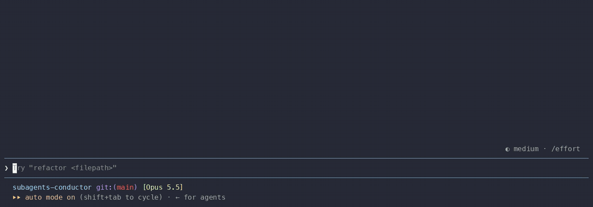

# subagents-conductor



A Claude Code mod that turns the subagent list under the prompt into a live pixel-art stage: a Claude-logo
conductor yelling at its subagents, one coloured figure per agent, and wires that light up while they work.

At a glance, for every subagent:
- **what it's doing right now**: 💻 command, 🔍 search, 📄 read, 📝 edit, 💭 thinking
- **how long** it has been running, its step count, model and tokens
- **health**: 🚨 stuck (no progress for 60 s, or one tool call running over 5 min), 🧟 zombie (nothing for 10 min), 💤 waiting
- **the final reply** flying back to main as a 📨 envelope

You can also click a subagent's name to open its transcript, and use `✖ stop` / `✖ stop all` to kill runaway agents in one click.

It spends **no tokens**: it only reads the agent list and the subagents' own steps.

## Install

At the prompt of a Claude Code terminal session:

```
/plugin install conductor --marketplace Naor-Yekutiely/subagents-conductor
```

Answer `y` to add the marketplace, then pick a scope (user scope loads it in every session).

From a shell:

```
claude plugin install conductor --marketplace Naor-Yekutiely/subagents-conductor
```

## Use

Ask Claude to start a few subagents. The stage appears under the prompt while they run.

- `/conductor big` shows 4 rows per agent (the default)
- `/conductor small` shows 2 rows per agent

The size you pick is remembered across sessions.

## Develop

```
claude --plugin-dir .          # run it from this folder
claude plugin validate .
claude plugin test .
```

The design notes are in [DESIGN.md](DESIGN.md).

## License

MIT
